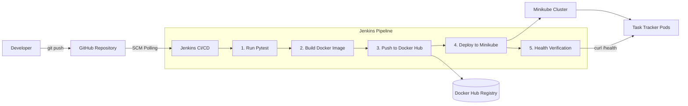

# Task Tracker CI/CD Pipeline

A complete end-to-end CI/CD implementation for **Task Tracker**, a Flask web application with a REST API, SQLite storage, and unit tests, deployed onto **Kubernetes (Minikube)** hosted on an **AWS EC2** instance via **Jenkins** and **Docker Hub**.

---

## 🏗 Architecture & Pipeline Overview



---

## 🚀 CI/CD Pipeline Stages

The automated workflow is defined in [`Jenkinsfile`](./Jenkinsfile) as a Declarative Pipeline:

| Stage | Description | Tools / Commands |
|---|---|---|
| **Checkout** | Clones the latest commit from the `main` branch. | Git SCM Plugin |
| **Test** | Installs dependencies into a clean virtual environment and runs tests. | `python3 -m venv`, `pytest` |
| **Docker Build** | Builds an optimized container image tagged with the Jenkins build number (`warxzeus/task-tracker:${BUILD_NUMBER}`). | `docker build` |
| **Push to Docker Hub** | Authenticates securely with Docker Hub using Jenkins credentials and pushes the image. | `docker login`, `docker push` |
| **Deploy to Minikube** | Replaces `IMAGE_PLACEHOLDER` with the newly built tag and applies manifests to Kubernetes. | `sed`, `kubectl apply -f k8s/` |
| **Verify** | Waits for deployment rollout, checks pod readiness, and curls `/health`. | `kubectl rollout status`, `curl` |
| **Post Actions** | Safely removes Docker authentication credentials from the runner. | `docker logout` |

---

## ☸️ Kubernetes Manifests

The application is deployed using declarative Kubernetes resources located in the [`k8s/`](./k8s) directory:

* **Deployment (`k8s/deployment.yaml`)**:
  * Manages the desired state and rolling update strategy.
  * Configured with **Readiness** and **Liveness Probes** targeting `/health` on port 5000 to ensure traffic only routes to healthy containers.
  * Pull policy set to `Always` to pull fresh images from Docker Hub.
* **Service (`k8s/service.yaml`)**:
  * Exposes the Flask app using a `NodePort` service.
  * Internal target port: `5000`
  * NodePort: `30080` (accessible across the cluster nodes).

---

## ⚙️ Infrastructure & Performance Tuning (t3.micro / 1 GB RAM)

Running a full Kubernetes cluster alongside Jenkins on an AWS EC2 `t3.micro` instance (1 vCPU, 1 GB RAM) presents strict resource constraints. The following system-level optimizations were implemented:

1. **JVM Memory Limits**:
   Configured Jenkins via systemd drop-in (`/etc/systemd/system/jenkins.service.d/override.conf`) with constrained heap bounds:
   ```ini
   [Service]
   TimeoutStartSec=600s
   Environment="JAVA_OPTS=-Xms256m -Xmx512m -Djenkins.install.runSetupWizard=false -Djava.io.tmpdir=/var/tmp"
   ```
2. **Swap Thrashing Prevention**:
   Tuned the Linux virtual memory subsystem to minimize disk I/O wait bottlenecks on AWS EBS:
   ```bash
   sudo sysctl -w vm.swappiness=1
   sudo sysctl -w vm.vfs_cache_pressure=50
   ```
3. **Automated Reverse Proxy & Port Forwarding**:
   * Redirected standard HTTP port 80 to Jenkins port 8080 via `iptables` for easy browser access.
   * Exposed Kubernetes NodePort `30080` to public interfaces for client traffic.

---

## 💻 Local Development

### 1. Run Application
```bash
# Clone the repository
git clone https://github.com/Sohamtakale/task-tracker.git
cd task-tracker

# Create and activate virtual environment
python3 -m venv venv
source venv/bin/activate

# Install dependencies
pip install -r requirements.txt

# Run server (port 5001 avoids macOS AirPlay port 5000 conflict)
PORT=5001 python3 app.py
```

### 2. Run Tests
```bash
pytest test_app.py -v
```

### 3. API Endpoints

| Method | Endpoint | Description |
|---|---|---|
| `GET` | `/` | Web UI Dashboard |
| `GET` | `/health` | Application health and version check |
| `GET` | `/api/tasks` | List all tasks |
| `POST` | `/api/tasks` | Create a new task (`{"title": "..."}`) |
| `PUT` | `/api/tasks/<id>/toggle` | Toggle task completion status |
| `DELETE` | `/api/tasks/<id>` | Delete a task |
